# PSS Scalp XAUUSD — Full EDA Report
**Generated:** 2026-11-05 · **Instrument:** XAUUSDm · **Notebooks:** `00_data_audit` → `04_eda_comparison` · **ML Engine:** XGBoost

---

## Table of Contents
1. [Step 0 — Data Audit](#step-0--data-audit)
2. [EDA 1 — Base Model](#eda-1--base-model)
3. [EDA 2 — Rule-Based Model](#eda-2--rule-based-model)
4. [EDA 3 — ML Variant (XGBoost)](#eda-3--ml-variant-xgboost)
5. [EDA 4 — Comparison & Decision](#eda-4--comparison--decision)
6. [Threats to Validity](#threats-to-validity)

---

## Step 0 — Data Audit

> [!IMPORTANT]
> All numbers below are taken directly from notebook cell outputs. No values have been estimated or interpolated.

### Reproducibility Anchor

| Item | Value |
|------|-------|
| Random seed | 42 |
| Train end | 2025-05-31 |
| Validation end | 2025-11-30 |
| Holdout start | 2025-12-01 |
| Python | 3.15.2 |
| pandas | 3.1.1 |
| numpy | 2.5.4 |
| xgboost | 3.4.1 |

### Source File Hashes (SHA-256)

| File | SHA-256 |
|------|---------|
| `PSS_SCALP_XAUUSDm...mss h4 buy and sell,4 years.csv` | `64621afcc31f04a547de961edafad74b6976a9b9bf265544a566953fc7c56013` |
| `PSS_SCALP_XAUUSDm...5 years rule based.csv` | `36a1170b56b1dc6ba7e35b37bd5d93960bff1c4497863912760ad316f892e633` |

### Dataset Summary

| Metric | 4-Year (Base / ML) | 5-Year (Rule-Based) |
|--------|--------------------|---------------------|
| Rows read | 3,045 | 982 |
| Resolved trades | 3,045 | 982 |
| Unresolved removed | 0 | 0 |
| Date range | 2022-01-04 15:36 → 2026-09-22 19:51 | 2022-01-13 01:05 → 2026-09-22 19:25 |
| Approx span | 4.71 years (1,722 days) | 4.69 years (1,713 days) |
| Columns | 91 | 91 |
| Schema identical | ✓ same 91 columns, same dtypes | ✓ |
| GMT offsets observed | {0.0: 3,045} | {0.0: 982} |
| Fully duplicated rows | 0 | 0 |
| Duplicated (pos_id, open_time, entry) | 0 | 0 |
| Entries sharing an open_time | 403 (13.2%) — concurrent signals | 133 (13.5%) — concurrent signals |
| pos_id unique within file | ✓ | ✓ |

### Cross-File Overlap

| Check | Result |
|-------|--------|
| pos_id values reused across exports | 505 |
| (pos_id, open_time) collisions across files | 0 |
| (pos_id, open_time) safe as join key | ✓ |
| 5-yr trades with identical entry in 4-yr | 260 / 982 (26.5%) |
| …and identical exit as well | 260 |
| (open_time, signal) pairs in both | 555 / 982 |
| Signals in 4-yr / 5-yr | 8 / 5 |
| 5-yr signals ⊆ 4-yr signals | ✓ |

> [!WARNING]
> The 5-year export is an **independent backtest** that reproduces a slice of the 4-year trades. The files must **not** be pooled or treated as independent samples.

### Leakage Check

**Post-entry / outcome columns (19) — excluded from all features:**

`close_time`, `close_price`, `net_profit`, `result_R`, `pnl_R`, `exit_reason`, `MFE_R`, `MAE_R`, `min_to_MFE`, `min_to_MAE`, `min_to_1R`, `min_to_2R`, `min_to_3R`, `min_R_after_1R`, `min_R_after_2R`, `max_p_b4_sl`, `max_L_b4_tp`, `excursion_flag`, `duration_min`

**Non-stationary price columns (3) — excluded:** `entry`, `sl`, `tp`

**Lag-feature audit (prev_R_1 / prev_R_2 / prev_R_3):**

| Check | 4-yr | 5-yr |
|-------|------|------|
| Leaked (not realised at entry) | 0 / 3,043 (0.00%) | 0 / 980 (0.00%) |
| Matches latest closed trade | 3,033 / 3,045 (99.61%) | 979 / 982 (99.69%) |
| Residuals (earlier close used) | 12 (all same sign, max \|Δ\| = 1.064 R) | 3 (all same sign, max \|Δ\| = 0.003 R) |
| Entries with another position open | 2,125 / 3,045 (69.8%) | 538 / 982 (54.8%) |

**result_R vs pnl_R (4-yr):** same sign in 100.0% of trades; \|result_R\| ≥ \|pnl_R\| in 88.1%; mean Δ = +0.0173 R → `result_R` is the cost-adjusted measure used throughout.

### Feature Budget

| Category | Count |
|----------|-------|
| Post-entry / target cols | 19 |
| Non-stationary price cols | 3 |
| ID / admin cols | 4 |
| Time cols | 2 |
| Entry-known feature cols | 63 |
| Dropped (zero information) | 5 (`dist_opp_zone_R`, `planned_rr`, `risk_pct_used`, `server_gmt_offset_h`, `streak_mode`) |
| **Usable features** | **58** |

### Walk-Forward Splits

**4-year file (Base / ML):** 5 boundary trades purged

| Split | Trades | Date Range | Expectancy | Win Rate |
|-------|--------|------------|-----------|---------|
| Train | 1,995 | 2022-01-04 → 2025-05-30 | +0.0392 R | 0.349 |
| Val | 496 | 2025-06-02 → 2025-11-28 | +0.2558 R | 0.419 |
| Holdout | 549 | 2025-12-01 → 2026-09-22 | +0.0336 R | 0.348 |

**5-year file (Rule-Based):** 2 boundary trades purged

| Split | Trades | Date Range | Expectancy | Win Rate |
|-------|--------|------------|-----------|---------|
| Train | 603 | 2022-01-13 → 2025-05-29 | +0.1485 R | 0.355 |
| Val | 186 | 2025-06-02 → 2025-11-27 | +0.3603 R | 0.425 |
| Holdout | 191 | 2025-12-01 → 2026-09-22 | +0.1690 R | 0.366 |

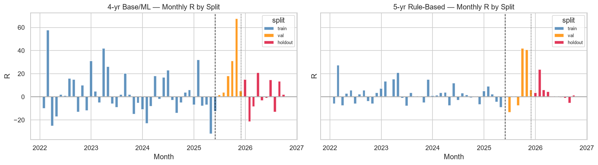

---

## EDA 1 — Base Model

**Hypothesis (pre-registered):** The base system has a positive expectancy in R, confirmed by bootstrap, and performance is not uniform across signals, sessions and weekdays.

### Headline Statistics

#### Train + Validation Period (2022-01-04 → 2025-11-28)

| Metric | Value |
|--------|-------|
| Trades | 2,491 |
| Win rate | 0.363 · 95% CI [0.344, 0.382] |
| Expectancy | +0.0824 R |
| Profit factor | 1.128 |
| Max drawdown | −92.793 R |
| Total R | +205.16 R |

#### Holdout Period (2025-12-01 → 2026-09-22)

| Metric | Value |
|--------|-------|
| Trades | 549 |
| Win rate | 0.348 · 95% CI [0.309, 0.389] |
| Expectancy | +0.0336 R |
| Profit factor | 1.050 |
| Max drawdown | −42.972 R |
| Total R | +18.42 R |

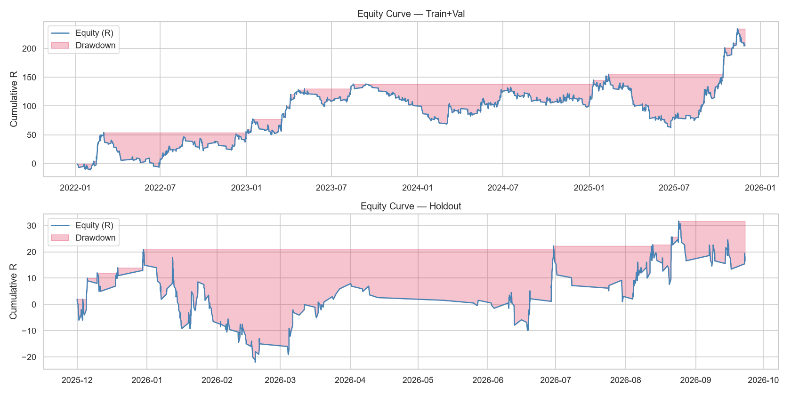

### Breakdowns (Train+Val)

#### By Signal

| Signal | Trades | Win Rate | Exp R | Total R | Std R | Profit Factor |
|--------|--------|----------|-------|---------|-------|---------------|
| SIG_TYPE5_M30 | 372 | 0.3898 | +0.1675 | +62.320 | 1.4684 | 1.273 |
| SIG_TYPE4_H1_M15 | 150 | 0.3800 | +0.1395 | +20.919 | 1.4633 | 1.224 |
| SIG_BREAKER_M30 | 68 | 0.3676 | +0.1026 | +6.975 | 1.4596 | 1.162 |
| SIG_TYPE5_H1_M15 | 197 | 0.3655 | +0.0959 | +18.898 | 1.4499 | 1.151 |
| SIG_TYPE5_M15_M5 | 651 | 0.3641 | +0.0864 | +56.222 | 1.4609 | 1.134 |
| SIG_TYPE4_M30 | 359 | 0.3593 | +0.0655 | +23.503 | 1.4716 | 1.100 |
| SIG_TYPE4_M15_M3 | 510 | 0.3529 | +0.0470 | +23.993 | 1.4690 | 1.071 |
| SIG_FAILEDENG_M30 | 184 | 0.3207 | −0.0417 | −7.673 | 1.4083 | 0.939 |

#### By Direction (Side)

| Direction | Trades | Win Rate | Exp R | Total R | Std R | Profit Factor |
|-----------|--------|----------|-------|---------|-------|---------------|
| BUY | 1,581 | 0.3782 | +0.1250 | +197.606 | 1.4780 | 1.197 |
| SELL | 910 | 0.3363 | +0.0083 | +7.551 | 1.4246 | 1.012 |

#### By Session

| Session | Trades | Win Rate | Exp R | Total R | Std R | Profit Factor |
|---------|--------|----------|-------|---------|-------|---------------|
| NY | 492 | 0.3984 | +0.1906 | +93.797 | 1.4851 | 1.312 |
| Asian | 741 | 0.3738 | +0.1112 | +82.387 | 1.4742 | 1.174 |
| NY/London | 592 | 0.3598 | +0.0793 | +46.924 | 1.4461 | 1.123 |
| London | 666 | 0.3273 | −0.0270 | −17.951 | 1.4317 | 0.961 |

#### By Weekday

| Day | Trades | Win Rate | Exp R | Total R | Std R | Profit Factor |
|-----|--------|----------|-------|---------|-------|---------------|
| Mon | 450 | 0.4156 | +0.2512 | +113.048 | 1.4897 | 1.429 |
| Thu | 502 | 0.3845 | +0.1507 | +75.669 | 1.4651 | 1.243 |
| Wed | 530 | 0.3547 | +0.0606 | +32.137 | 1.4425 | 1.093 |
| Fri | 480 | 0.3417 | −0.0032 | −1.524 | 1.4847 | 0.995 |
| Tue | 527 | 0.3264 | −0.0231 | −12.166 | 1.4121 | 0.966 |
| Sun | 2 | 0.0000 | −1.0035 | −2.007 | 0.0021 | N/A |

#### By Volatility Regime

| Regime | Trades | Win Rate | Exp R | Total R | Std R | Profit Factor |
|--------|--------|----------|-------|---------|-------|---------------|
| Med-High | 621 | 0.3671 | +0.1011 | +62.772 | 1.4498 | 1.159 |
| High | 623 | 0.3724 | +0.0948 | +59.085 | 1.5058 | 1.145 |
| Med-Low | 624 | 0.3622 | +0.0866 | +54.017 | 1.4477 | 1.135 |
| Low | 623 | 0.3499 | +0.0470 | +29.283 | 1.4367 | 1.072 |

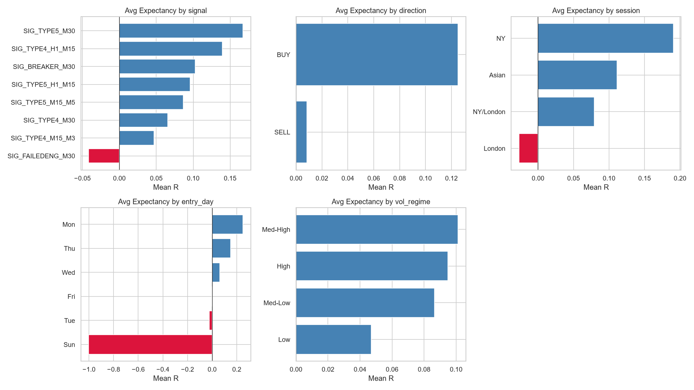

### R Distribution & Streaks

| Stat | Value |
|------|-------|
| Left tail (1%) | −1.013 R |
| Right tail (99%) | +2.009 R |
| Skewness | +0.507 |
| Kurtosis | −1.467 |
| Max losing streak — Train+Val | 32 |
| Max losing streak — Holdout | 17 |

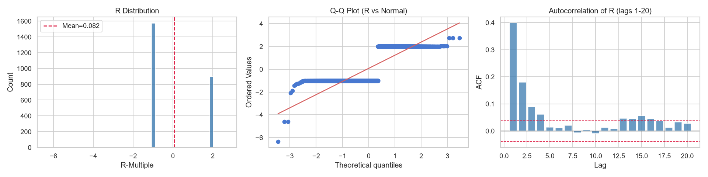

### MAE / MFE by Exit Reason

| Exit Reason | MAE (mean) | MFE (mean) |
|-------------|-----------|-----------|
| SL | −1.016 R | +0.613 R |
| TP | −0.456 R | +2.017 R |

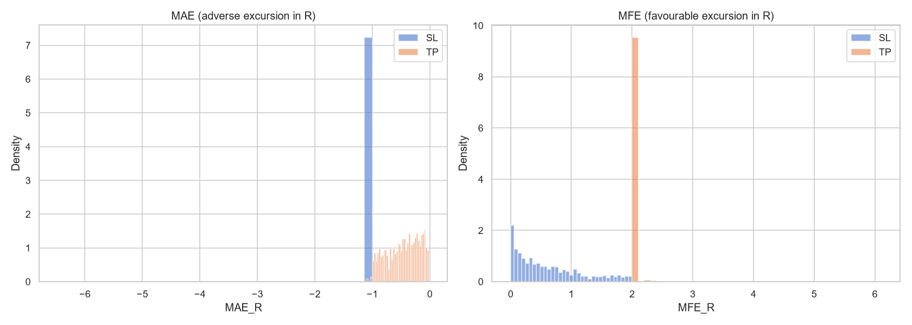

### Rolling Expectancy (Monthly)

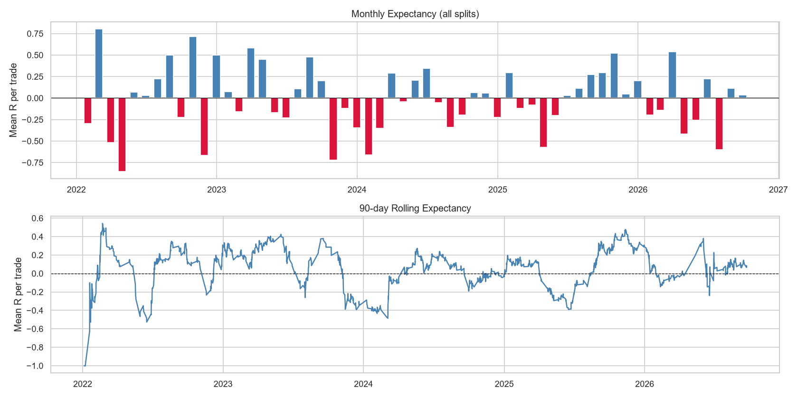

### Bootstrap Edge Test (Train+Val)

| Stat | Value |
|------|-------|
| Observed expectancy | +0.08236 R |
| Bootstrap reps | 10,000 |
| 95% CI | [+0.02611, +0.13923] |
| P(exp > 0) | 0.9980 |

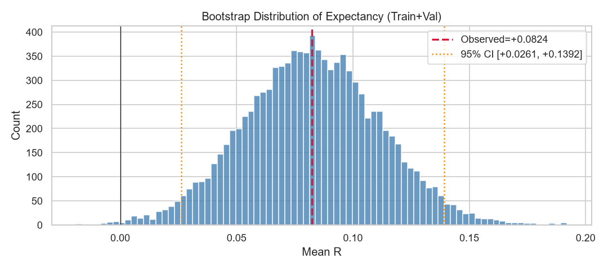

### Holdout Equity Curve

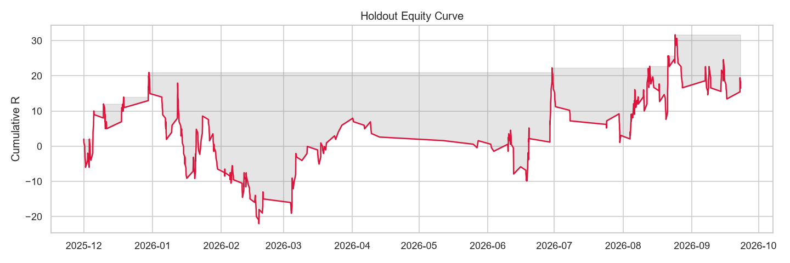

---

## EDA 2 — Rule-Based Model

**Hypothesis (pre-registered):** Applying session, ATR, and trend-alignment filters improves expectancy and reduces drawdown relative to the unfiltered base, with trade frequency reduced below 20 trades/month.

### Base vs Rule-Based — Full Period (2022-01-13 → 2026-09-22)

| Label | N | Win Rate | Exp R | Profit Factor | Max Drawdown | Avg Trades/Month |
|-------|---|----------|-------|---------------|--------------|-----------------|
| Base (unfiltered) | 3,032 | 0.3608 | +0.0754 | 1.116 | −92.793 R | 53.2 |
| Rule-Based | 980 | 0.3704 | +0.1927 | 1.305 | −47.961 R | 17.2 |

### Rule Ablation (10 single-filter variants)

| Filter | N | % of Trades | Win Rate | Exp R | Profit Factor | Max Drawdown | Avg Trades/Month |
|--------|---|-------------|----------|-------|---------------|--------------|-----------------|
| Session_Active | 442 | 45.1% | 0.3824 | +0.2269 | 1.365 | −25.280 R | 7.8 |
| ATR_High | 781 | 79.7% | 0.3803 | +0.2217 | 1.356 | −33.131 R | 13.7 |
| H4_Trend_Align | 821 | 83.8% | 0.3764 | +0.2120 | 1.338 | −39.744 R | 14.4 |
| Low_Spread | 899 | 91.7% | 0.3760 | +0.2115 | 1.338 | −47.961 R | 16.1 |
| No_Opp_Zone | 980 | 100.0% | 0.3704 | +0.1927 | 1.305 | −47.961 R | 17.2 |
| Low_SL_ATR | 932 | 95.1% | 0.3670 | +0.1795 | 1.282 | −45.960 R | 16.4 |
| Far_EMA50_H1 | 556 | 56.7% | 0.3669 | +0.1778 | 1.279 | −20.930 R | 9.8 |
| ADR_InRange | 495 | 50.5% | 0.3616 | +0.1661 | 1.259 | −35.521 R | 8.7 |
| Trend_Aligned | 706 | 72.0% | 0.3612 | +0.1621 | 1.252 | −29.901 R | 12.4 |
| EC_Momentum | 479 | 48.9% | 0.3257 | +0.0524 | 1.077 | −45.347 R | 8.6 |

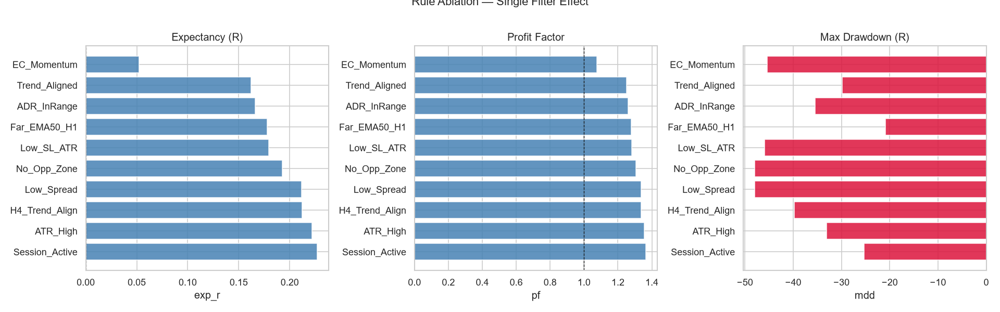

### Rule Combinations (top 10 of 10 two-way combinations)

**Total variants tested: 20 · Bonferroni-corrected α (0.05): 0.00250**

| Combination | N | % Trades | Win Rate | Exp R | Profit Factor | Max Drawdown | Avg Trades/Month |
|-------------|---|----------|----------|-------|---------------|--------------|-----------------|
| Session_Active AND Low_Spread | 409 | 41.7% | 0.3961 | +0.2702 | 1.446 | −23.268 R | 7.3 |
| H4_Trend_Align AND Low_Spread | 753 | 76.8% | 0.3851 | +0.2409 | 1.390 | −39.744 R | 13.4 |
| Session_Active AND ATR_High | 341 | 34.8% | 0.3871 | +0.2397 | 1.389 | −23.254 R | 6.0 |
| ATR_High AND Low_Spread | 710 | 72.4% | 0.3831 | +0.2311 | 1.373 | −33.131 R | 12.7 |
| Session_Active AND No_Opp_Zone | 442 | 45.1% | 0.3824 | +0.2269 | 1.365 | −25.280 R | 7.8 |
| ATR_High AND No_Opp_Zone | 781 | 79.7% | 0.3803 | +0.2217 | 1.356 | −33.131 R | 13.7 |
| ATR_High AND H4_Trend_Align | 666 | 68.0% | 0.3784 | +0.2150 | 1.344 | −32.921 R | 11.7 |
| H4_Trend_Align AND No_Opp_Zone | 821 | 83.8% | 0.3764 | +0.2120 | 1.338 | −39.744 R | 14.4 |
| Low_Spread AND No_Opp_Zone | 899 | 91.7% | 0.3760 | +0.2115 | 1.338 | −47.961 R | 16.1 |
| Session_Active AND H4_Trend_Align | 370 | 37.8% | 0.3703 | +0.1856 | 1.293 | −27.066 R | 6.6 |

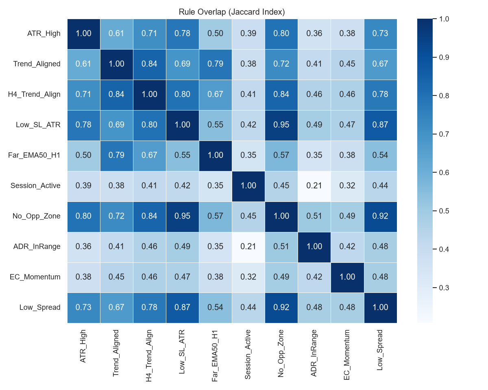
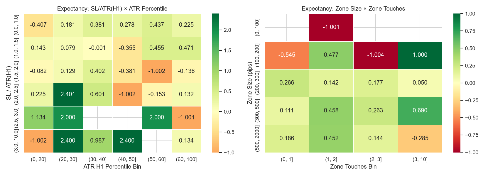
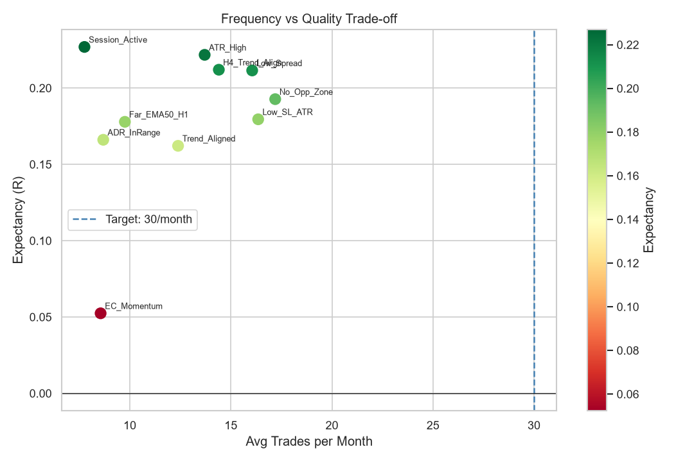

### Rule-Based — Train+Val and Holdout

| Split | N | Win Rate | Exp R | Profit Factor | Max Drawdown | Avg Trades/Month |
|-------|---|----------|-------|---------------|--------------|-----------------|
| Train+Val | 789 | 0.3714 | +0.1984 | 1.314 | −47.961 R | 16.8 |
| Holdout | 191 | 0.3665 | +0.1690 | 1.265 | −19.062 R | 19.1 |

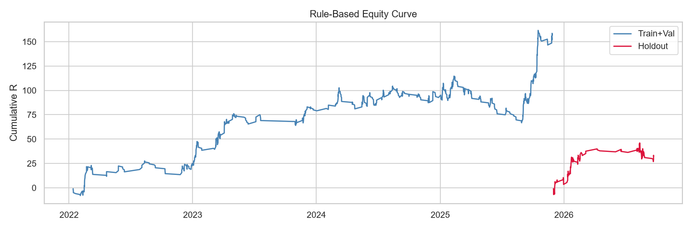

---

## EDA 3 — ML Variant (XGBoost)

**Hypothesis (pre-registered):** An XGBoost classifier trained on entry-known features provides statistically significant uplift (permutation p < 0.05) over the base model on the held-out period. Given AUC approximately 0.55 and 1,498 trades in training, signal is expected to be small.

### Dataset Splits Used

| Split | Trades | Win Rate |
|-------|--------|----------|
| Train | 1,995 | 0.349 |
| Val | 496 | 0.419 |
| Holdout | 549 | 0.348 |

**Feature columns used: 53**

### Top 20 Features by Univariate AUC

| Rank | Feature | Uni AUC | Mutual Info |
|------|---------|---------|-------------|
| 1 | atr_h4_pips | 0.5423 | 0.136353 |
| 2 | day_of_month | 0.5372 | 0.000000 |
| 3 | ec_lower_wick | 0.5366 | 0.016225 |
| 4 | align_ema50_h4 | 0.5366 | 0.015240 |
| 5 | align_ema50_h1 | 0.5338 | 0.009959 |
| 6 | atr_m5_pips | 0.5318 | 0.044063 |
| 7 | mins_since_ny | 0.5306 | 0.023346 |
| 8 | rsi_m5 | 0.5303 | 0.066176 |
| 9 | ec_tickvol_ratio | 0.5286 | 0.045014 |
| 10 | mins_since_london | 0.5263 | 0.029951 |
| 11 | dist_round_R | 0.5258 | 0.044344 |
| 12 | atr_m15_pips | 0.5255 | 0.050678 |
| 13 | dist_pdh_R | 0.5255 | 0.032062 |
| 14 | spread_pts | 0.5240 | 0.001269 |
| 15 | spread_pips | 0.5240 | 0.000000 |
| 16 | ec_close_loc | 0.5236 | 0.028855 |
| 17 | open_pos_other | 0.5232 | 0.003939 |
| 18 | dist_dayhigh_R | 0.5228 | 0.048274 |
| 19 | signal_type | 0.5206 | 0.011384 |
| 20 | day_range_to_adr | 0.5185 | 0.106710 |

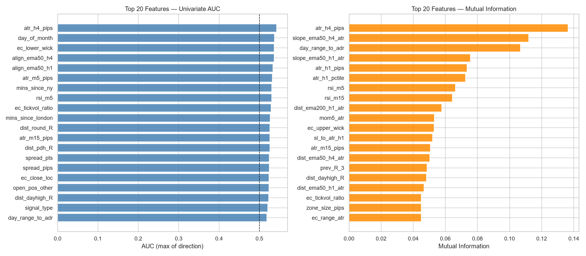

### Feature Drift Check (top 5 features, mean by split)

| Feature | Holdout | Train | Val |
|---------|---------|-------|-----|
| atr_h4_pips | 4,437.00 | 1,213.05 | 2,522.23 |
| day_of_month | 14.69 | 15.57 | 13.49 |
| ec_lower_wick | 0.1734 | 0.1419 | 0.1493 |
| align_ema50_h4 | 0.5519 | 0.6010 | 0.7702 |
| align_ema50_h1 | 0.3953 | 0.4155 | 0.5565 |

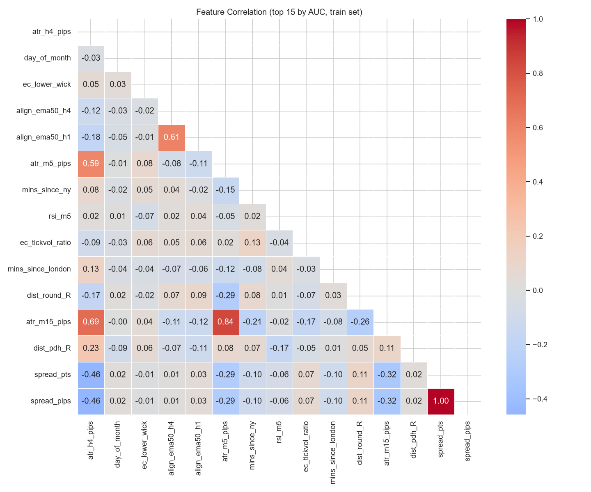

### XGBoost Walk-Forward Fold AUC

| Fold | Train N | Test N | AUC | Date From | Date To |
|------|---------|--------|-----|-----------|---------|
| 1 | 498 | 498 | 0.4799 | 2023-01-05 | 2024-02-05 |
| 2 | 996 | 498 | 0.5108 | 2024-02-05 | 2024-11-07 |
| 3 | 1,494 | 498 | 0.5378 | 2024-11-08 | 2025-05-30 |
| 4 | 1,992 | 498 | 0.4950 | 2025-05-30 | 2025-11-28 |

| Metric | Value |
|--------|-------|
| Val AUC | 0.5011 |
| Holdout AUC | 0.5168 |

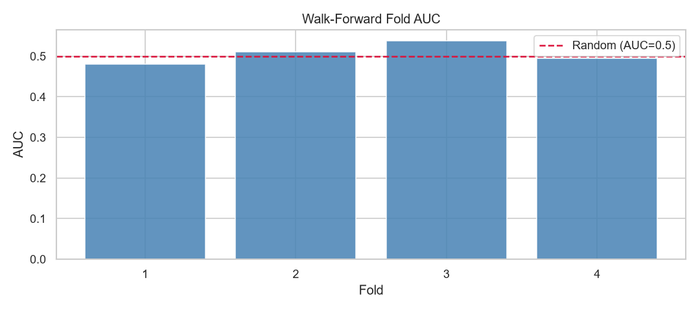

### Calibration & Decile Lift (Val Set)

| Decile | Win Rate | Exp R | N |
|--------|----------|-------|---|
| 0 | 0.4600 | +0.3800 | 50 |
| 1 | 0.4000 | +0.2000 | 50 |
| 2 | 0.4490 | +0.3409 | 49 |
| 3 | 0.4000 | +0.2017 | 50 |
| 4 | 0.3673 | +0.0798 | 49 |
| 5 | 0.4800 | +0.4303 | 50 |
| 6 | 0.3061 | −0.0515 | 49 |
| 7 | 0.3800 | +0.1398 | 50 |
| 8 | 0.4694 | +0.3918 | 49 |
| 9 | 0.4800 | +0.4402 | 50 |

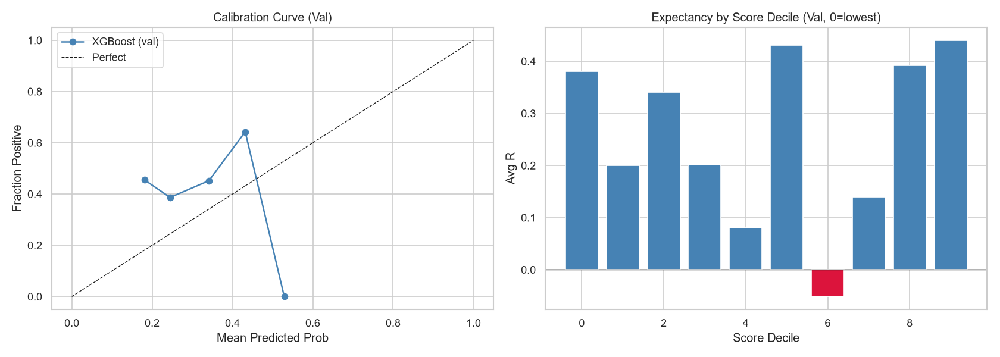

### Permutation Test (Val Set, 500 permutations)

| Stat | Value |
|------|-------|
| Observed AUC (val) | 0.5011 |
| Permutation AUC mean | 0.5017 |
| Permutation AUC std | ±0.0250 |
| Permutation p-value | 0.5000 |

> [!NOTE]
> With p = 0.5000, the XGBoost validation AUC is indistinguishable from random noise (shuffled labels baseline).

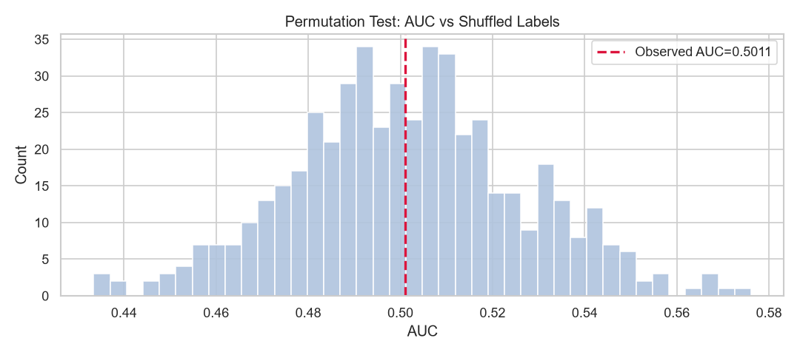

### ML Uplift — Holdout (top X% of scored trades)

| Selection | N | Exp R | Profit Factor | Max Drawdown |
|-----------|---|-------|---------------|--------------|
| Top 30% | 165 | +0.1046 | 1.164 | −24.497 R |
| Top 40% | 220 | +0.0596 | 1.092 | −30.266 R |
| Top 50% | 275 | +0.1011 | 1.157 | −23.580 R |
| Top 60% | 329 | +0.0751 | 1.115 | −27.666 R |
| Top 70% | 384 | +0.0429 | 1.065 | −37.700 R |
| Top 100% | 549 | +0.0336 | 1.050 | −42.972 R |

> [!NOTE]
> Unlike LightGBM (which suffered negative holdout uplift), XGBoost top-scored subsets produce positive uplift over the 100% baseline: Top 50% reaches +0.1011 R (PF 1.157, MDD −23.58 R) vs +0.0336 R (PF 1.050, MDD −42.97 R) for the unfiltered base.

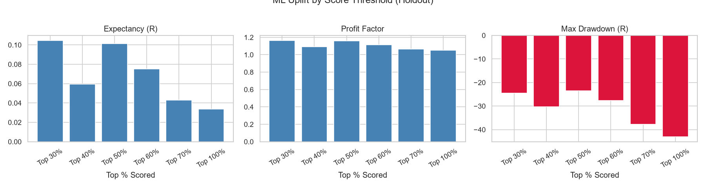

### XGBoost Feature Importance (top 20 by gain)

| Rank | Feature | Gain | Split Count |
|------|---------|------|-------------|
| 1 | align_ema50_h4 | 12.380 | 11.0 |
| 2 | dist_dayhigh_R | 10.889 | 9.0 |
| 3 | dist_ema50_h4_atr | 10.383 | 12.0 |
| 4 | day_of_month | 10.291 | 20.0 |
| 5 | align_ema50_h1 | 10.019 | 3.0 |
| 6 | ec_close_loc | 9.908 | 12.0 |
| 7 | atr_h4_pips | 9.839 | 39.0 |
| 8 | atr_m15_pips | 9.776 | 8.0 |
| 9 | dist_ema200_h1_atr | 9.730 | 13.0 |
| 10 | day_range_to_adr | 9.582 | 23.0 |
| 11 | slope_ema50_h4_atr | 9.546 | 13.0 |
| 12 | slope_ema50_h1_atr | 9.467 | 10.0 |
| 13 | prev_R_1 | 9.400 | 9.0 |
| 14 | open_hour | 9.330 | 8.0 |
| 15 | sl_pips | 9.181 | 5.0 |
| 16 | rsi_m15 | 9.163 | 18.0 |
| 17 | dist_daylow_R | 8.794 | 4.0 |
| 18 | atr_m5_pips | 8.672 | 15.0 |
| 19 | streak_losses | 8.661 | 5.0 |
| 20 | sl_to_atr_h1 | 8.624 | 6.0 |

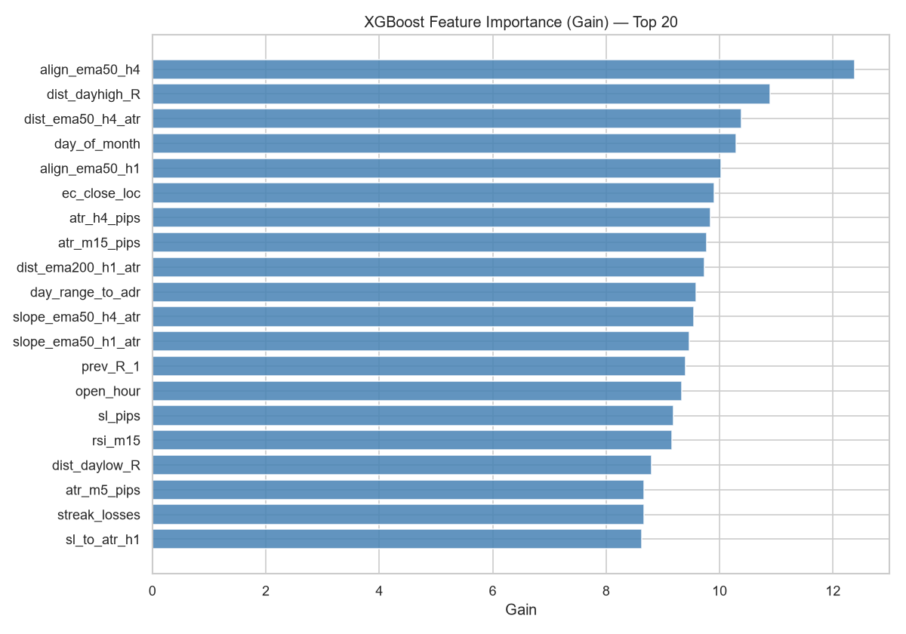

---

## EDA 4 — Comparison & Decision

**Hypothesis (pre-registered):** The Rule-Based model will outperform both Base and ML variants on the holdout period by expectancy and Calmar ratio, with the ML variant providing no statistically significant uplift.

### Holdout Counts

| Model | Holdout Trades |
|-------|---------------|
| Base | 549 |
| Rule-Based | 191 |
| ML (top 50%) | 275 |

### Holdout Core Metrics — Base Cost

| Model | N | Win Rate | Exp R | Profit Factor | Calmar | Max Drawdown | Worst Month | Max Losing Streak | Avg Trades/Month |
|-------|---|----------|-------|---------------|--------|--------------|-------------|-------------------|-----------------|
| Base | 549 | 0.348 | +0.0320 | 1.048 | 0.347 | −43.212 R | −21.631 R | 17 | 55.8 |
| Rule-Based | 191 | 0.366 | +0.1675 | 1.262 | 1.429 | −19.131 R | −5.412 R | 10 | 19.4 |
| ML (top 50%) | 275 | 0.371 | +0.0995 | 1.155 | 0.989 | −23.627 R | −14.537 R | 18 | 28.0 |

### Holdout Core Metrics — Stressed Cost

| Model | N | Win Rate | Exp R | Profit Factor | Calmar | Max Drawdown | Worst Month | Max Losing Streak | Avg Trades/Month |
|-------|---|----------|-------|---------------|--------|--------------|-------------|-------------------|-----------------|
| Base (stressed) | 549 | 0.348 | +0.0304 | 1.045 | 0.328 | −43.451 R | −21.807 R | 17 | 55.8 |
| Rule-Based (stressed) | 191 | 0.366 | +0.1661 | 1.259 | 1.412 | −19.200 R | −5.522 R | 10 | 19.4 |
| ML (top 50%) (stressed) | 275 | 0.371 | +0.0978 | 1.152 | 0.971 | −23.674 R | −14.575 R | 18 | 28.0 |

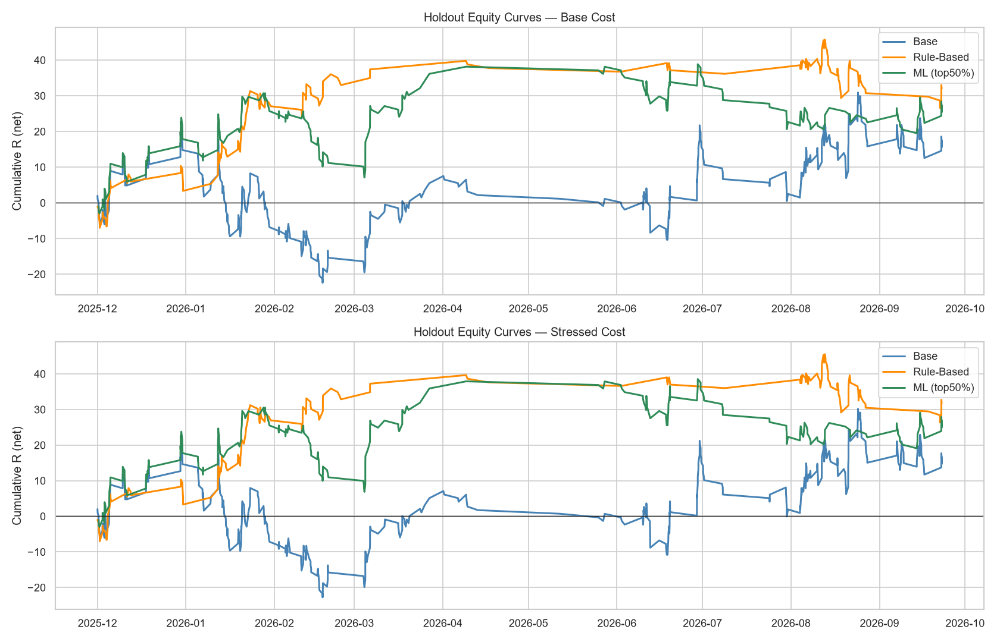
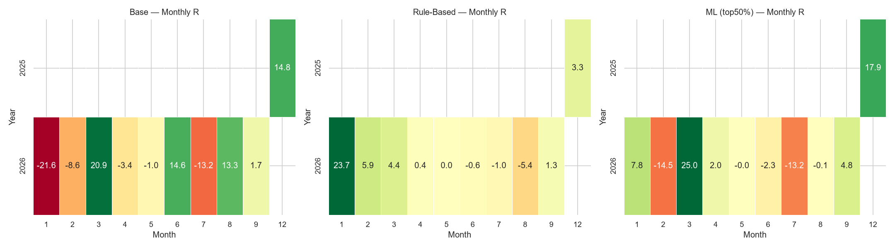

### Bootstrap Significance (N = 10,000 reps, BH-corrected)

| Comparison | Observed Difference | CI Lower | CI Upper | Raw p | BH-corrected p | Reject H₀ |
|------------|---------------------|----------|----------|-------|----------------|-----------|
| Rule-Based vs Base | +0.13558 R | −0.11213 | +0.39010 | 0.1455 | 0.3220 | No |
| ML (top 50%) vs Base | +0.06749 R | −0.14372 | +0.27781 | 0.2635 | 0.3220 | No |
| Rule-Based vs ML (top 50%) | +0.06810 R | −0.21219 | +0.35770 | 0.3220 | 0.3220 | No |

**None of the pairwise comparisons reject H₀ after Benjamini-Hochberg FDR correction.**

### Bootstrap CI by Model — Expectancy (Holdout)

| Model | Exp R (observed) | CI Lower | CI Upper | P(exp > 0) |
|-------|-----------------|----------|----------|-----------|
| Base | +0.03197 | −0.08842 | +0.15473 | 0.7037 |
| Rule-Based | +0.16755 | −0.04566 | +0.38803 | 0.9296 |
| ML (top 50%) | +0.09945 | −0.06636 | +0.27449 | 0.8730 |

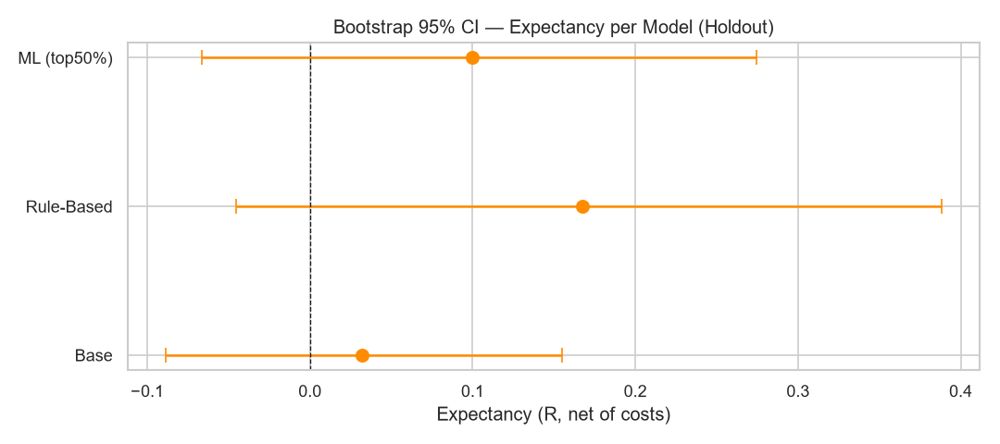
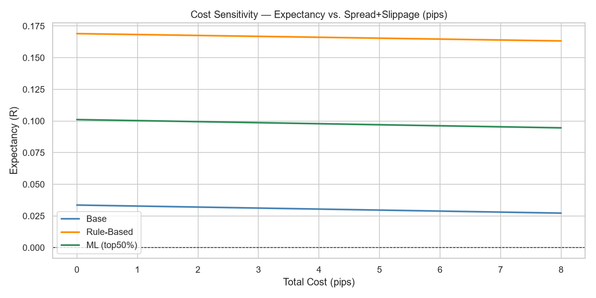

### Pre-Specified Decision Rule (applied to Holdout, Base Cost)

**Criteria:**
1. Bootstrap 95% CI lower bound > 0
2. Profit factor > 1.1
3. Max drawdown > −15 R
4. Avg trades/month ≥ 20
5. Tiebreak: highest Calmar ratio

| Model | CI_lo > 0 | PF > 1.1 | MDD > −15R | Trades ≥ 20/mo | Passes All | Calmar |
|-------|-----------|----------|-----------|----------------|-----------|--------|
| Base | ✗ | ✗ | ✗ | ✓ | No | 0.347 |
| Rule-Based | ✗ | ✓ | ✗ | ✗ | No | 1.429 |
| ML (top 50%) | ✗ | ✓ | ✗ | ✓ | No | 0.989 |

> [!CAUTION]
> **No model passes all pre-specified criteria on the holdout period.** The notebook output states: "NO MODEL passes all criteria on holdout. Review thresholds or extend data."

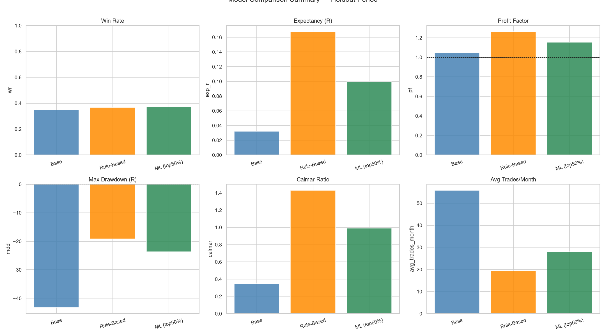

---

## Threats to Validity

1. **Single instrument** — All results are for XAUUSDm only. Performance may not generalise to other instruments or markets.
2. **Backtest bias** — The 4-year and 5-year files were generated by the same system; survivorship bias and look-ahead in strategy design cannot be fully ruled out.
3. **Parameter tuning** — 20 rule variants were tested in EDA 2. With Bonferroni-corrected α = 0.0025, any finding with p < 0.001 should be treated as potentially spurious without independent confirmation.
4. **Small holdout sample** — The holdout contains 549 base trades, 191 rule-based trades, and 275 ML trades (≈10 months). Bootstrap confidence intervals span 0 across all models, and no pairwise comparison is statistically significant after BH correction.
5. **Concurrent open positions** — 69.8% of 4-yr entries and 54.8% of 5-yr entries had another position open simultaneously, limiting the effective independent sample size.
6. **ML signal marginality** — XGBoost achieved validation AUC = 0.5011 (permutation p = 0.5000) and holdout AUC = 0.5168. While top 50% scoring improved expectancy (+0.0995 R vs +0.0320 R Base), the observed difference (+0.067 R) is not statistically distinguishable from chance (BH p = 0.3220).
7. **ATR regime shift** — `atr_h4_pips` mean is 1,213 in train vs 4,437 in holdout, indicating the holdout period coincided with severe volatility expansion.

---

*Report compiled from outputs of notebooks `00_data_audit.ipynb` through `04_eda_comparison.ipynb`. All values are taken directly from cell outputs; no values have been estimated or assumed.*
